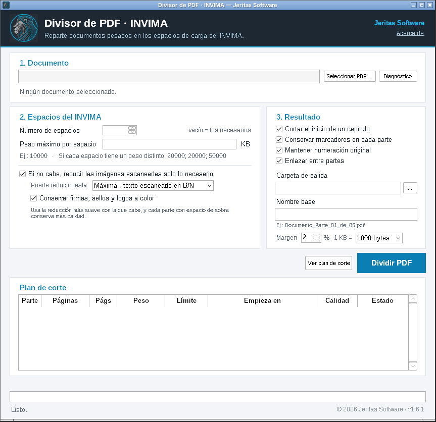
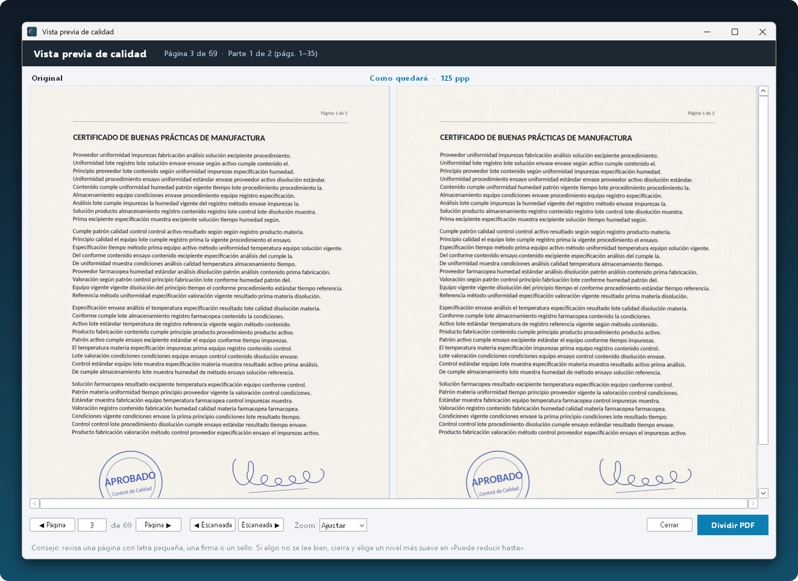
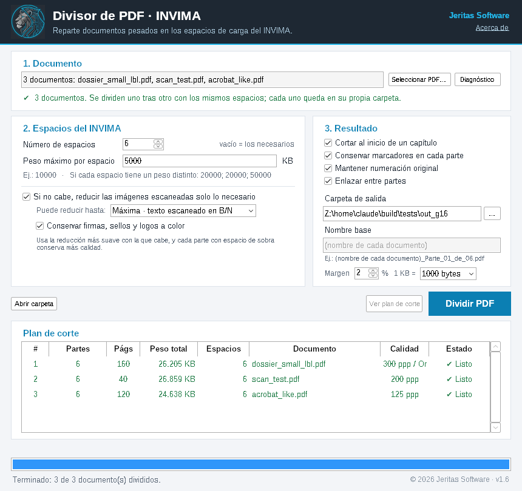
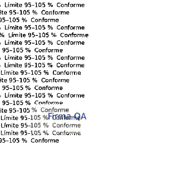

  

<h1 align="center">Divisor de PDF · INVIMA</h1>

  Reparte documentos PDF pesados en los espacios de carga de la plataforma del INVIMA. 
  Gratis · Sin internet · Tus documentos nunca salen de tu computador.

  <a href="https://github.com/Jeritas/Divisor-PDF-INVIMA-Descargas/releases/latest"><b>⬇️ Descargar la última versión</b></a>

---

## ¿Para qué sirve?

La plataforma del INVIMA da un número de espacios para cargar la documentación, cada uno con un peso máximo, y los expedientes suelen pesar mucho más. Este programa:

- **Divide el PDF** en el número de partes que indiques, con el peso máximo de cada espacio (iguales o distintos, por ejemplo `20000; 20000; 50000` KB).
- **No pierde calidad si el documento cabe**: las páginas se copian tal cual, idénticas al original.
- **Si no cabe, reduce solo lo necesario**, empezando por la reducción más suave. Únicamente toca las imágenes escaneadas: el texto digital, las tablas y los gráficos no cambian. Las firmas, los sellos y los logos se conservan a color.
- **Corta en lugares lógicos**, al inicio de capítulos, y conserva el índice, la numeración de páginas y los enlaces.
- **Divide varios documentos a la vez.**
- Genera un **resumen en Excel** con las páginas, el peso y el límite de cada parte.
- Tiene una **vista previa** para comparar la calidad antes de dividir.
- No necesita Acrobat ni ningún otro programa.

## Instalación

1. Ve a **[Descargas](https://github.com/Jeritas/Divisor-PDF-INVIMA-Descargas/releases/latest)** y descarga el archivo `DivisorPDF_Jeritas_Instalador_vX.Y.Z.exe`.
2. Ábrelo. **Windows mostrará el aviso "Windows protegió su PC"** (ver más abajo por qué). Haz clic en **"Más información"** y luego en **"Ejecutar de todas formas"**.
3. Acepta la licencia y sigue los pasos. **No necesita permisos de administrador.**
4. Abre el programa desde el escritorio, desde el menú Inicio (*Jeritas Software*) o con **clic derecho sobre cualquier PDF → "Dividir con Divisor de PDF"**.

¿No te dejan instalar programas en el computador del trabajo? Descarga el archivo `DivisorPDF_Jeritas_Portable_vX.Y.Z.zip`, descomprímelo, por ejemplo en una USB, y abre `DivisorPDF.exe`.

**Requisitos:** Windows 10 u 11 de 64 bits.

## ¿Por qué aparece "Windows protegió su PC"?

Windows muestra ese aviso con **cualquier programa nuevo** que no se descarga de la Microsoft Store y que todavía no ha descargado mucha gente. **No significa que tenga virus**: significa que Windows aún no lo conoce. A medida que más personas lo usan, el aviso deja de aparecer.

Para que puedas confiar en el archivo:

- **Funciona sin internet.** El programa no se conecta a ningún servidor y tus documentos nunca salen de tu computador. Esto es importante cuando trabajas con información confidencial de expedientes.
- **Cada versión publica su huella digital (SHA-256)** en la página de descarga. Si quieres comprobar que tu archivo es exactamente el publicado, en PowerShell ejecuta `Get-FileHash .\DivisorPDF_Jeritas_Instalador_vX.Y.Z.exe` y compara el resultado.
- Puedes analizar el instalador tú mismo en **[VirusTotal](https://www.virustotal.com)**, que lo revisa con unos 70 antivirus.

## Cómo se usa

1. **Selecciona el PDF**, o varios.
2. En **"Espacios del INVIMA"**, escribe el número de espacios y el peso máximo en KB que indica la plataforma para tu trámite.
3. Pulsa **"Ver plan de corte"** para ver qué páginas van en cada parte, o **"Dividir PDF"** para hacerlo directamente.
4. Las partes quedan en la carpeta **"Partes INVIMA"**, con nombres como `Documento_Parte_01_de_06.pdf`, junto con un resumen para Excel.

Si el documento hay que reducirlo, antes de dividir puedes abrir la **vista previa** y comparar cada página original con como quedará, con zoom.

**Consejo:** usa el PDF **original**. Si antes lo comprimes con otro programa, las imágenes se comprimen dos veces y pierden más calidad de la necesaria.

## Preguntas frecuentes

**¿Cuánto cuesta?** Nada. Es de uso gratuito.

**¿Se pierde calidad?** Si el documento cabe en los espacios, no se pierde nada. Si no cabe, el programa reduce solo las imágenes escaneadas y solo lo necesario. Antes de dividir puedes ver la vista previa y comparar la página original con la reducida.

**¿Las firmas y los sellos se ven?** Sí. Cuando una página escaneada de texto pasa a blanco y negro, las zonas con color (firmas, sellos, logos) se conservan a color.

*Las imágenes de esta página usan un expediente de ejemplo con datos ficticios.*

**Al abrir una parte sale "la ruta no existe".** Windows y Acrobat no abren archivos cuya ruta completa pase de 260 caracteres, algo común en carpetas de SharePoint u OneDrive. El programa lo detecta antes de guardar y ofrece una carpeta corta.

**¿Funciona con documentos muy grandes?** Sí, está probado con PDF de varios GB y miles de páginas.

**Encontré un problema o tengo una sugerencia.** Escríbela en **[Issues](https://github.com/Jeritas/Divisor-PDF-INVIMA-Descargas/issues)**.

## Licencia

Copyright (c) 2026 **Jeritas Software**.

Este software ha sido desarrollado por Jeritas Software. Su uso está destinado a la gestión documental. **Uso gratuito.** Se permite usar y compartir el programa sin modificaciones. Queda prohibida su venta, su modificación o su distribución como parte de otro producto sin autorización. El software se entrega "tal cual", sin garantías.

Incluye componentes de terceros (Python, pikepdf/qpdf, Pillow, PDFium, lxml) bajo sus propias licencias; ver [AVISOS_TERCEROS.txt](AVISOS_TERCEROS.txt), que también viene en la carpeta del programa.
